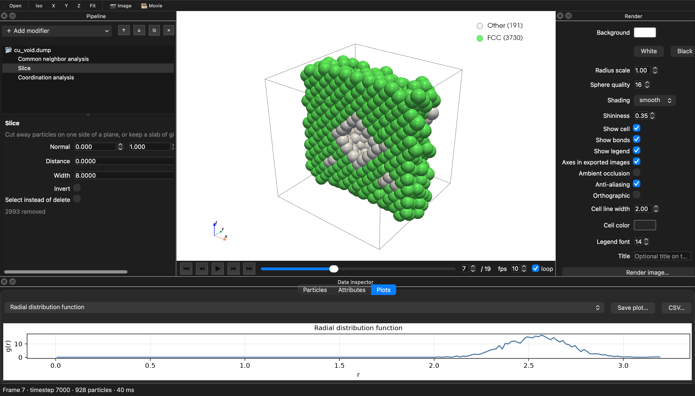

# AtomView

Free, open-source visualization and analysis for atomistic, colloidal and active-matter simulations, with
Python script modifiers, batch rendering and a scripting API included at no cost.
On top of that, it runs **MATLAB / GNU Octave `.m` scripts** inside the pipeline.



## Why AtomView

- Free and MIT licensed, no paid tier: scripting, batch, CLI and PTM included.
- Opens `.mat` (v5, v7, v7.3) directly; runs MATLAB/Octave `.m` scripts in the pipeline.
- One command renders thousands of folders: last, all or every Nth frame, all cores, resumable.
- 2D and soft-matter analysis built in: hexatic, g6(r), polar/nematic order, MSD, alpha2, Fs(k,t), VACF.
- Headless on clusters: switches to software rendering when there is no display.
- Sessions are plain JSON with relative paths, so projects move between machines.
- Plugins are a single `.py` file.

## Start

macOS: double-click `AtomView.command`. Windows: double-click `AtomView.bat`. Linux: `./atomview.sh`. Or:

```bash
.venv/bin/atomview examples/data/cu_void.dump
```

## Download and install as an app

Ready-to-run builds for Windows, macOS and Linux (no Python needed) come from the `build` GitHub workflow:
Actions > build > Run workflow, or push a tag like `v0.2.0` to attach them to a release. Each one has `AtomView`
(the app) and `atomview-cli` (the command line, e.g. `atomview-cli batch FOLDER`).

| System | Install | Then |
|---|---|---|
| **macOS** | Unzip, drag `AtomView.app` into Applications. Not code-signed: right-click > Open the first time. | Double-click a `.atomview` session to open it; data files (`.xyz`, `.dump`, `.mat`, `.pdb`, ...) list AtomView under right-click > Open With. |
| **Windows** | Run `AtomView-...-windows-setup.exe` (no administrator rights needed). | Start menu entry (desktop icon optional); `.atomview` sessions open on double-click; data files list AtomView under Open with. Uninstall from Settings > Apps. |
| **Linux** | Unpack the `.tar.gz` anywhere, then run `./install.sh` in that folder. | AtomView appears in the application menu and `.atomview` sessions open on double-click. `./install.sh --uninstall` removes it. |

AtomView never takes over a data format from another program (for example `.mat` stays with MATLAB); it is
added as a choice under Open With.

To build the app yourself on macOS and install it for your account:

```bash
cd packaging && ../.venv/bin/pyinstaller atomview.spec --noconfirm --distpath ../dist --workpath ../build/pyi
ditto ../dist/AtomView.app ~/Applications/AtomView.app
```

## Sessions

**File > Save session** (Ctrl+S / Cmd+S) writes a `.atomview` file with everything needed to come back to
the same state: the data file (and topology), every modifier with its settings and on/off state, the render
settings, camera, current frame, animation speed and the selected pipeline entry. **Save session as...**
(Ctrl+Shift+S) writes a copy. The window title shows the session name and a `*` when there are unsaved
changes, and closing asks before discarding them.

- Sessions store the data path both absolute and relative to the session file, so a project folder that is
  moved or copied to another computer (or between Windows, macOS and Linux) still opens. If the data file
  cannot be found, AtomView asks you to locate it.
- Open a session by double-clicking it, dropping it on the window, **File > Open session...**, **File >
  Open recent**, or `atomview my.atomview`.
- The command line uses the same file: `atomview render -s my.atomview -o fig.png` (the data file comes from
  the session), or `atomview batch FOLDER -s my.atomview` to apply its pipeline to every folder.
- A session is plain JSON. Older `.json` sessions still open.

## Install on another machine

Copy or clone this folder (you can leave out `.venv`), then:

**Ubuntu / Linux**

```bash
sudo apt install python3-venv libosmesa6 libgl1 libegl1 libxcb-cursor0
python3 -m venv .venv && .venv/bin/pip install -e .
```

`libosmesa6` lets it render images with no display, for example over SSH or on a cluster node: when no
`DISPLAY` is set, AtomView switches to software rendering by itself. `libxcb-cursor0` is only needed for the GUI.

**Windows** (PowerShell, with Python 3.10+ from python.org)

```powershell
py -m venv .venv
.venv\Scripts\pip install -e .
```

Then `.venv\Scripts\atomview` (or `AtomView.bat`). To get a real app with double-click file opening, use
the builds above.

## Batch: images for every folder

Give it a folder. It goes into every sub-folder and, by default, renders the **last frame** of the **last**
`.xyz` or `.mat` file in each one:

```bash
atomview batch /data/simulations                    # image saved next to each file (final.mat -> final.png)
atomview batch /data/simulations -o /data/figures   # all images in one folder: runA__sub__final.png
atomview batch D:\sims -o D:\figures                # Windows paths work too
atomview batch /data/sims -o figs --frames all -j 0             # every frame, all cores
atomview batch /data/sims -o figs --frames every5 -j 0          # every 5th frame: frames 0, 5, 10, ...
atomview batch /data/sims -o figs --files all --frames every5   # one snapshot per file: every 5th file
```

`--frames` counts over the snapshots of a folder: the frames of the last file, or with `--files all` the frames
of every matching file in order (so a folder of `snap_0.xyz ... snap_999.xyz` works the same as one trajectory
file). Images of a multi-frame file get the frame number: `run1__traj_00005.png`. On 10 cores, 1000 folders
take 16 s for the last frame each and 55 s for every 5th of 20 frames (800x600, 864 particles).

| Option | Meaning |
|---|---|
| `-s session.atomview` | apply the modifiers and render settings saved from the GUI (File → Save session) |
| `--pattern "*.xyz,*.mat,*.dump"` | which files count (default `*.xyz,*.mat`) |
| `--pick mtime` | "last" = newest modification time (default: last by name, natural order so `step_10` > `step_9`) |
| `--frames SPEC` | `last` (default), `first`, `all`, `every5`, `::5`, `--frames=-10:` (last 10), `0,50,100` |
| `--files all` | take snapshots from all matching files in order, not just the last one |
| `-j N` | parallel processes; `-j 0` = one per core |
| `--size 3000x2000`, `--view +z`, `--format pdf`, `--transparent`, `--ao` | image options |
| `--skip-existing` | skip images newer than their data file, so an interrupted or extended run picks up where it left off |
| `--no-recursive` | only the folder itself |

### Thousands of folders, per operating system

The commands and options are the same everywhere; only paths, quoting and the program name differ. With a
standalone build, use `atomview-cli` (`atomview-cli.exe` on Windows) in place of `atomview`.

**Linux** (desktop, SSH or a cluster node; no display needed when `libosmesa6` is installed):

```bash
atomview batch /data/sims -o /data/figs --frames every5 -j 0 --skip-existing
nohup atomview batch /data/sims -o /data/figs --frames all -j 0 --skip-existing > batch.log 2>&1 &   # survives logout
```

On a cluster, give `-j` the number of cores you were allocated (e.g. `-j $SLURM_CPUS_PER_TASK`), since `-j 0`
counts every core of the node. Over SSH, rendering uses software OpenGL (CPU), so more cores help directly.

**Windows** (PowerShell or Command Prompt; quote paths that contain spaces):

```powershell
atomview batch "D:\My Sims" -o "D:\Figures" --frames every5 -j 0 --skip-existing
.\AtomView\atomview-cli.exe batch "D:\My Sims" -o "D:\Figures" --files all --frames all -j 8
```

Windows runs at most 61 worker processes, so `-j` is capped there.

**macOS**:

```bash
atomview batch ~/sims -o ~/figs --frames every5 -j 0 --skip-existing
caffeinate -i atomview batch ~/sims -o ~/figs --frames all -j 0   # keeps the Mac awake for long runs
```

With the downloaded app, the command line is `AtomView.app/Contents/MacOS/atomview-cli`.

**From MATLAB** (any OS): `B = atomview.batch('/data/sims', '/data/figs', {}, [], [], '--frames=every5 -j 0');`
returns the summary as a table.

Stopping a run (Ctrl+C) and starting it again with `--skip-existing` renders only the images still missing.
For one-frame-per-folder runs, parallelism is per folder; a single folder with many frames uses one process.

Each run writes `batch_summary.csv` (file, frame, particle count, timestep, status). A file that fails to read
is reported and skipped; it doesn't stop the run. The same feature is in the GUI: **File → Batch render
folder…** (⌘B / Ctrl+B), which uses the pipeline and render settings you have open.

**`.mat` files** are read with no conversion (MATLAB v5/v7 and v7.3/HDF5). Variable names are matched
case-insensitively, and a file holding one struct (`data.pos`, …) is unwrapped:

| What | Recognised names | Shapes |
|---|---|---|
| positions | `Position`, `pos`, `coords`, `xyz`, `r` (or separate `x`, `y`, `z`) | N×3, 3×N, or N×3×F trajectory |
| types | `type`, `types`, `atom_type`, `species`, `elements` | numbers, or element names (`'Cu'`) |
| cell | `Cell`, `box`, `lattice`, `h` / `BoxSize`, `L` / `bounds` | 3×3, 3 lengths, 3×2 lo/hi |
| also | `Origin`, `pbc`, `Timestep`, `id`; any other N-row array becomes a property | |

With no cell, the bounding box of the atoms is used and the boundaries are treated as non-periodic.

## What it does

**Files:** LAMMPS dump (text or `.gz`, orthogonal or triclinic, scaled or unwrapped, any extra columns), LAMMPS
data, XYZ / extended XYZ, MATLAB `.mat`, POSCAR/CONTCAR. Through chemfiles: XTC, TRR, DCD, Amber NetCDF, TNG, GRO,
PDB (bonds, residues), MOL2, TPR, PSF, MMTF and more. Trajectories without atom names (XTC, DCD, ...) use a
same-named `.gro`/`.pdb`/`.psf`/`.tpr` next to them, or `--topology` / File > Open trajectory + topology. Anything ASE reads also works: CIF, PDB, XDATCAR, OUTCAR, GRO, XSF, CFG,
`.traj`, and more. Trajectories are indexed lazily, so big dumps open instantly. Use a wildcard (`dump.*.gz`) to
load a numbered series of files.

**Pipeline:** a stack of modifiers you can reorder, toggle and duplicate, re-evaluated live as you edit.

| Category | Modifiers |
|---|---|
| Coloring | Color coding (16 colormaps, outlier-robust range, legend), Assign color, Set radius, Set transparency |
| Selection | Expression selection (`type == 2 && z > 10`), Select type (numbers or element names), Invert, Clear |
| Modification | Slice (half-space or slab), Delete selected, Compute property, Replicate, Wrap at periodic boundaries |
| Analysis | Adaptive common neighbor analysis (FCC/HCP/BCC/ICO), Centrosymmetry, Coordination + RDF, Cluster analysis, Displacement vectors, Steinhardt q_l, Hexatic psi_6 (2D), Voronoi volume/coordination, Histogram |
| Soft matter | Structure factor S(k), polar and nematic order (global and local), bond-orientational correlation g6(r) (2D), particle trails |
| Structure | Polyhedral template matching (FCC, HCP, BCC, ICO, SC, cubic/hex diamond, graphene) with RMSD, lattice orientation, interatomic distance, elastic deformation gradient, chemical ordering (L1_0, L1_2, B2, ...) |
| Strain | Atomic strain: von Mises shear, volumetric, Green-Lagrangian tensor, non-affine D2min |
| Trajectory | MSD(t), non-Gaussian parameter alpha2(t), self-intermediate scattering Fs(k,t), velocity autocorrelation (Analysis > Trajectory dynamics, `atomview dynamics`) |
| Visual | Create bonds (global or per type pair; bonds across periodic boundaries drawn correctly), Vectors (arrows from velocity/force/N x 2 data or a 2D angle) |
| Scripting | **Python script** (`def modify(frame, data)`), **MATLAB / Octave script** (`.m` file or inline) |

**2D systems** (colloids, active matter): N x 2 positions, or files whose particles all share one z, load as 2D, with a top-down view, per-area RDF normalization and hexatic order.

**Large systems:** above 30k particles spheres are drawn as GPU imposters (Render panel, Spheres). A 1M-atom image renders in about 1 s using about 0.2 GB extra memory. `.mat` v7.3 trajectories are read one frame at a time.

**Viewer:** trajectory timeline with playback, view presets, orthographic toggle, and right-click an atom to see
its properties. The data inspector has a filterable particle table, global attributes and plots (RDF, histograms,
cluster sizes), each exportable to CSV, PNG, PDF or SVG.

**Figures:** export at any resolution with optional transparent background, ambient occlusion, PBR shading,
legends/colorbars, and a title. Formats: PNG, JPG, TIFF and vector SVG/PDF/EPS. Animations export as MP4, GIF or AVI.
Sessions (pipeline + render settings + camera) save to JSON.

## Scripting

Full guide for Python and MATLAB: [docs/SCRIPTING.md](docs/SCRIPTING.md). MATLAB toolbox: `addpath('AtomView/matlab')`,
then `atomview.render(S,'fig.png')`, `atomview.load(...)`, `atomview.animate(...)`, `atomview.dynamics(...)`.

**Python modifier**: runs for every frame. `data` is the particle frame.

```python
def modify(frame, data):
    data['height'] = data.positions[:, 2]          # new property
    data['selection'] = data['c_pe'] > -3.0        # select
    data.attributes['MeanPE'] = data['c_pe'].mean()
```

**MATLAB / Octave modifier**: your `.m` script gets `Position` (N×3), every property by name (`type`, `id`, `c_pe`,
…), and `Cell`, `Origin`, `Timestep`, `Frame`, `N`. Every N-row variable you create becomes a property, every scalar
becomes an attribute, and `DeleteMask` removes particles. MATLAB is used if installed. Otherwise install the free
GNU Octave (`brew install octave`, `sudo apt install octave`, or the Windows installer). It is found in the
standard install locations on macOS, Linux and Windows. Set `ATOMVIEW_MATLAB` or `ATOMVIEW_OCTAVE` to the
executable if yours is somewhere else. MATLAB (or Octave) is started once and kept running, so after a few seconds' start each frame costs about
0.1 s (measured: 0.09 s/frame vs 8.3 s for a fresh process per frame). Every frame runs in a fresh workspace, so
no variables carry over. Turn off "Keep MATLAB running" to use a fresh process per frame instead.

```matlab
d = Position - (Origin + 0.5*sum(Cell,1));
distance_from_center = sqrt(sum(d.^2, 2));
selection = distance_from_center < 9;
```

**Your own Python programs**, run with AtomView's bundled Python:

```python
import atomview as av
from atomview import modifiers as m

pipe = av.Pipeline(av.load("dump.lammpstrj"))
pipe.add(m.CommonNeighborAnalysis())
pipe.add(lambda frame, data: print(frame, data.attributes["CNA.counts.FCC"]))
av.render_image(pipe, "fig.png", frame=0, size=(2400, 1800))
av.render_animation(pipe, "movie.mp4")
```

**Plugins:** drop a `.py` file that defines `Modifier` subclasses into `~/.atomview/plugins/` (or a folder in `ATOMVIEW_PLUGIN_PATH`), or ship a package with an `atomview.modifiers` entry point. Plugin modifiers appear in the Add modifier menu. `atomview plugins` lists them and reports load errors.

**Command line:**

```bash
atomview batch /data/sims -o /data/figures -s session.atomview
atomview render dump.lammpstrj -s session.atomview -o fig.png --size 3000x2000 --ao
atomview animate dump.lammpstrj -s session.atomview -o movie.mp4 --every 5
atomview run dump.lammpstrj analysis.m -o processed.xyz
atomview info POSCAR
atomview convert dump.lmp results.mat -m "PolyhedralTemplateMatching()"   # pipeline results for MATLAB
atomview script my_analysis.py arg1                                     # Python with atomview (also in builds)
atomview msd traj.mat -o msd.csv --dt 0.01
```

## Tests

```bash
.venv/bin/python -m pytest tests          # core: readers, CNA, scripts, writers
.venv/bin/python tests/gui_smoke.py build # opens the GUI, adds every modifier, screenshots
```

`.github/workflows/test.yml` runs the tests and headless batch renders (serial and parallel) on Ubuntu, Windows and macOS when the
folder is pushed to GitHub.

## Not yet

Where the established tools are still ahead:

- **Analysis:** dislocation extraction (DXA), surface meshes, grain segmentation, Wigner-Seitz defect
  counting, spatial binning and time averaging.
- **Biomolecules:** no cartoon or ribbon representations, secondary structure, volumetric data (density maps,
  cube files) or isosurfaces.
- **Rendering:** no ray-traced or path-traced renderer, and no interactive measuring of distances and angles in
  the viewport.
- **Scale:** tested up to about 1M particles; tools written in C++ handle far larger systems interactively.
- **Maturity:** a young project with one developer and a small user base, so less documentation, fewer
  validated edge cases and no long citation record.
- **Builds:** not code-signed (macOS and Windows show a warning the first time), the macOS build is for Apple
  silicon only, and downloads are 200 to 400 MB.

See [docs/ROADMAP.md](docs/ROADMAP.md).

MIT licensed (bundled third-party code: [THIRD_PARTY_NOTICES.md](THIRD_PARTY_NOTICES.md)). Built on VTK/PyVista, freud, ASE, NumPy/SciPy, Matplotlib and Qt (PySide6).
